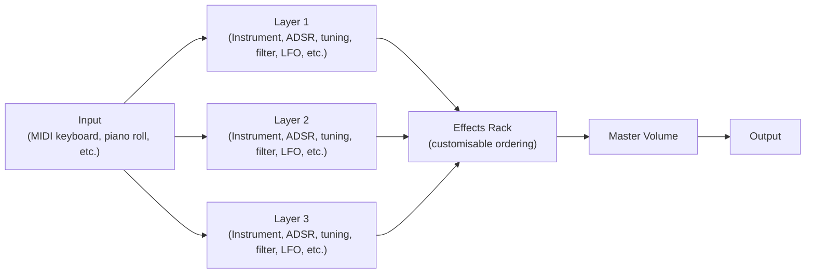

{/*
SPDX-FileCopyrightText: 2025 Sam Windell
SPDX-License-Identifier: CC-BY-SA-4.0
*/}

import GeneratedScreenshot from '@site/src/components/GeneratedScreenshot';
import LibraryFeature from '@site/src/components/LibraryFeature';
import LibraryName from '@site/src/components/LibraryName';

<GeneratedScreenshot name="page-layers" alt="Floe's window with the LAYERS page tab highlighted" />

<LibraryName>Floe</LibraryName> is built around three layers, each holding a sound of its own, playing together as one.

For each layer, you pick a sound source, its _Instrument_, then shape it further with envelopes, filters, an LFO, looping and more.

A sound can use a single layer or blend two or three together. The LAYERS page is where you control all aspects of these identical layers.

## How sound flows through the engine

When you play a note, all three layers play at once (unless a layer is limited to a [key range](./config-tab#key-ranges)). Each is processed on its own, then the three are mixed together and sent through the [effects rack](./effects) and the master volume. A layer with no Instrument is simply silent.

## The layer layout

<GeneratedScreenshot name="layers" alt="Floe's Layers page with the parts of a layer numbered" />

1. **Layer header** — the layer's Instrument and its mixing controls, always visible.
1. **Tabs** — switch between the layer's groups of controls: _PLAYBACK_, _MAIN_, _LFO_, _EQ_, _ARP_ and _CONFIG_. A dot on the _EQ_, _LFO_ or _ARP_ tab shows that it's switched on.
1. **Tab controls** — the controls for the selected tab. Each tab has its own chapter. You can right-click these to copy, paste or reset all of its settings at once. It's a quick way to give two layers the same configuration.
1. **All-layer buttons** — these act on all three layers together. <FAIcon icon="fa-solid fa-shuffle" /> loads a random Instrument into every layer, with each layer following its own Instrument browser filters (see [Randomisation](./randomisation)). <FAIcon icon="fa-solid fa-xmark" /> clears every layer.

## Layer header

<GeneratedScreenshot name="layer-top-controls" alt="A layer's header with its controls numbered" />

1. **Instrument selector** — shows the layer's Instrument. Click it to open the [Instrument browser](./browsers) and choose a different one. Right-click for more options: unload the Instrument, copy and paste the Instrument or the whole layer, or swap this layer with the one to its left or right (macro assignments move with a swapped layer).
1. **Instrument navigation** — the arrows <FAIcon icon="fa-solid fa-caret-left" /> <FAIcon icon="fa-solid fa-caret-right" /> step to the previous or next Instrument, and <FAIcon icon="fa-solid fa-shuffle" /> jumps to a random one: a quick way to audition sounds without opening the browser. They follow the filters you've set in the Instrument browser, so they only move between the Instruments that match. <FAIcon icon="fa-solid fa-xmark" /> unloads the Instrument, leaving the layer empty and silent.
1. **Mute and Solo** — _Mute_ silences this layer, and _Solo_ lets you hear it on its own. Silenced layers keep running in the background, so if you unmute or unsolo them they carry on seamlessly from wherever they've got to. To save CPU, unload the Instrument instead. It's simplest to just use either Solo or Mute across the layers, not both — if you do mix them, Solo is prioritised over Mute.
1. **Volume** — the layer's level, with its level meter alongside. While notes are sounding, red marks on the slider show the level of each voice. A voice's level depends on its velocity, where it falls in a [key range](./config-tab#key-ranges) fade, and any MPE volume expression.
1. **Pan and Stereo** — _Pan_ places the layer anywhere from left to right. It uses a constant-power pan law (-3 dB at centre), so the layer keeps the same perceived loudness wherever you put it. _Stereo_ narrows or widens the layer: negative values pull it toward mono, positive values push it wider. Pan comes after Stereo, so you can narrow a wide sound and then place it as a single point. A mono sound has nothing to widen, so pushing it to maximum stereo width silences it.
1. **Detune and Pitch** — _Pitch_ moves the layer up or down in semitones, and _Detune_ fine-tunes it in cents (hundredths of a semitone). Both work by speeding up or slowing down the audio. Right-click _Pitch_ to jump up or down an octave. Right-click _Detune_ and choose _Fold into Pitch_ to move any whole semitones from _Detune_ into _Pitch_, leaving the overall tuning unchanged.<LibraryFeature has="pitched-multisamples"> For a multi-sampled Instrument, _Transpose_ on the [CONFIG tab](./config-tab) may sound more natural.</LibraryFeature>

See [Controls](./controls) for the ways to adjust knobs, sliders and number fields.

## The tabs

Below the header, each layer's controls are grouped into six tabs. Each has its own chapter:

- [**PLAYBACK**](./playback-tab) — how the layer plays its samples: play mode, sample start, reverse, [granular synthesis](./playback-tab#granular-synthesis) and [looping](./playback-tab#looping).
- [**MAIN**](./main-tab) — the [volume envelope](./main-tab#volume-envelope) and [filter](./main-tab#filter).
- [**LFO**](./lfo-tab) — add movement to various aspects.
- [**EQ**](./eq-tab) — a three-band equaliser to shape the layer's tone.
- [**ARP**](./arp-tab) — the arpeggiator, which turns held notes into rhythmic patterns.
- [**CONFIG**](./config-tab) — how the layer responds to your playing: transpose, pitch bend, keytracking, monophonic, MPE, [key ranges](./config-tab#key-ranges) and the velocity curve.

Right-click a tab to copy, paste or reset all of its settings at once. Copy a tab on one layer and paste it into another to give both layers the same settings, or reset a tab to start it afresh.

<GeneratedScreenshot name="layer-tab-menu" alt="The menu that opens when you right-click a layer's MAIN tab" />
